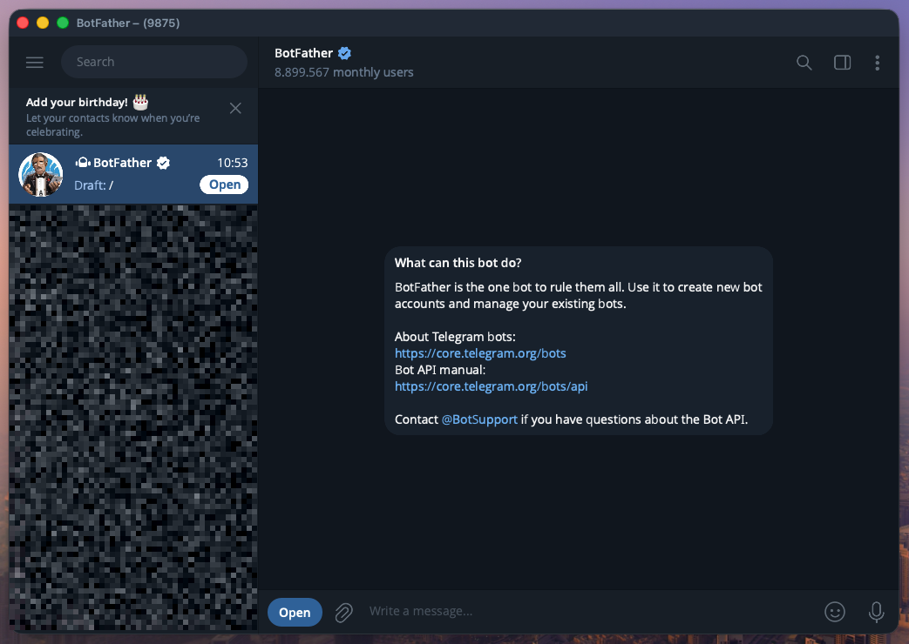
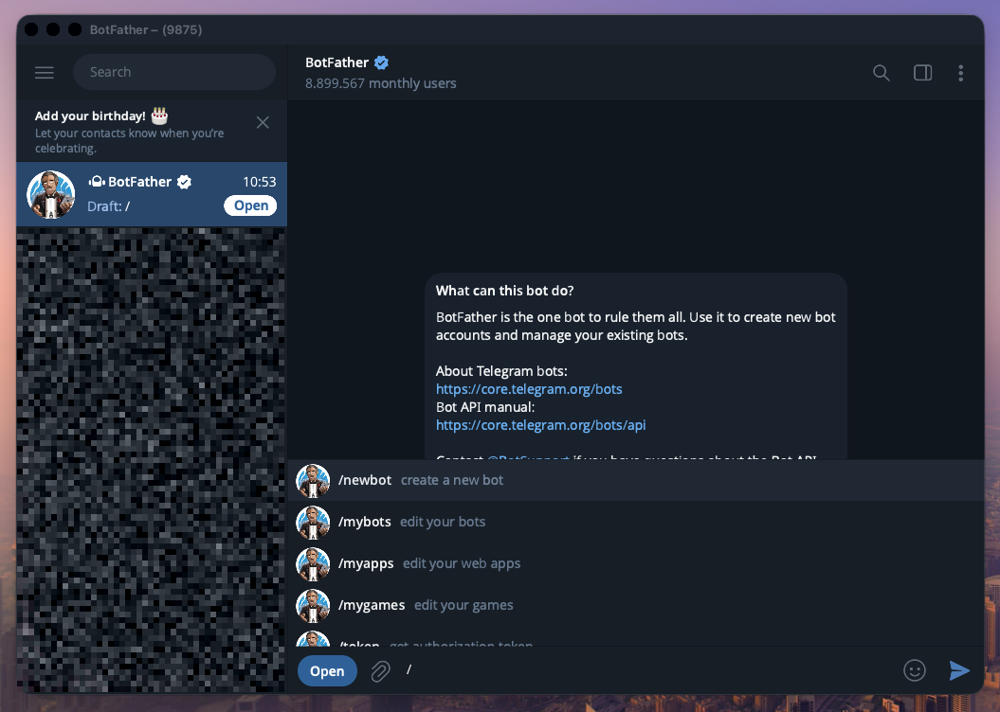
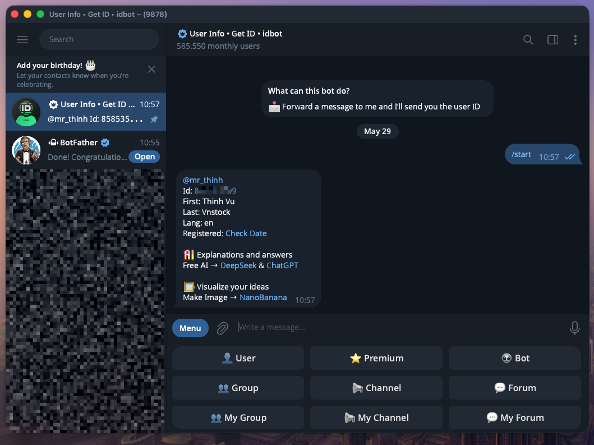

# Antigravity Telegram Gateway (Go Version)

*[Đọc bản Tiếng Việt (Vietnamese version)](docs/README-vi.md)*

A Telegram Bot written in Golang, acting as a gateway bridge for [Antigravity CLI](https://dev.to/arindam_1729/antigravity-cli-a-hands-on-guide-to-googles-terminal-coding-agent-5bc7). This version **operates independently**, not using any 3rd-party API wrappers to ensure maximum security, directly communicating with Telegram via RAW HTTP.

This document provides a detailed guide on how to configure the Telegram Bot with BotFather, install, secure, and run the bot 24/7.

> [!CAUTION]
>
> **Security Warning**: Running the Antigravity CLI involves authenticating with your personal Google account. Deploying this bot on a public, shared, or poorly secured web server poses significant security risks. If the server is compromised by a hacker, they could potentially gain control over your agent and access the Google services linked to your account.
> **Recommendation**: Only deploy this gateway in secure, private environments such as your personal machine, a private home server, or dedicated and isolated internal servers not exposed to public web traffic.

---

## ❓ Why Antigravity & Telegram?

[Antigravity CLI](https://dev.to/arindam_1729/antigravity-cli-a-hands-on-guide-to-googles-terminal-coding-agent-5bc7) provides a powerful, terminal-based AI coding agent. However, using it typically requires sitting at a computer and interacting with a terminal interface.

By bridging Antigravity CLI with **Telegram**, this project unlocks the ability to:

- **Control your AI agent from anywhere**: You can command your agent to write code, manage servers, or run background tasks directly from your phone while on the go.
- **Lightweight interface**: No need to install heavy IDEs or SSH apps on your mobile devices. Telegram's native app provides a fast, familiar, and accessible UI.
- **Always-on autonomy**: Deploy this on a home server or VPS, and your agent is ready 24/7 to receive instructions and report back to your chat.
- **Maximize your Google AI Plan**: Since Antigravity CLI authenticates directly via your Google account, you can fully utilize your existing AI service plans (like Ultra) without paying for expensive third-party API services. Additionally, using some unofficial UI wrappers (like OpenClaw) might risk your account being restricted for abuse, whereas this CLI mode is a completely legitimate and official way to interact with the AI.

---

## 🌟 Key Features

- **Absolute Security**: API calls are made directly via `net/http` without potentially risky wrappers.
- **Sandbox Security 🛡️**: Restricts the AI to read/write files ONLY within pre-authorized directories (`ALLOWED_DIRS`).
- **Access Control (Whitelist)**: Only serves pre-configured User IDs or Chat Group IDs.
- **Concurrency Lock**: Prevents bot spamming, ensuring each user runs only one main thread at a time.
- **Long Message Support**: Automatically splits (chunks) responses when the AI's output exceeds Telegram's 4096-character limit.
- **Slash Commands**:
    - `/new`: Start a brand-new conversation.
    - `/dir <path>`: Change the working directory (Sandbox).
    - `/goal <prompt>`: Run a fully autonomous task in the background.
    - `/grill_me <prompt>`: Force the bot to ask you questions to clarify an idea.
    - `/browser <prompt>`: Force the bot to use a browser.
    - `/schedule <time> <prompt>`: Schedule a command execution.

---

## 🛠 Part 1: Setting up the Bot on Telegram with BotFather

To create a bot on Telegram, you don't need a website; everything happens directly within the Telegram app via **BotFather**.

### Step 1: Create a Bot and Get the Token

1. Open the Telegram app, search for the **@BotFather** account (with a verified blue tick), and click Start.



2. Type the command `/newbot` to create a new bot.



3. BotFather will ask for the bot's name (e.g., `Antigravity Bot`).
4. Next, enter a username for the bot (must end with `bot`, e.g., `my_antigravity_bot`).
5. If successful, BotFather will send you an **HTTP API Token** (formatted like `123456789:ABCDefghIJKLmnopQRSTuvwxyz`).
   👉 **Copy and save this token**, this is the `TELEGRAM_BOT_TOKEN` you need to enter into the `.env` file.

### Step 2: Privacy Settings (Required for Groups)

If you plan to add the bot to a Group Chat and want it to read **all** messages (without typing `/` or tagging the bot's name):

1. Send the command `/setprivacy` to BotFather.
2. Select your bot from the menu.
3. Select **Disable**. (The state `Privacy mode is disabled` means the bot will see all messages in the group).

### Step 3: Get Your User ID

Telegram secures access via User ID (a numeric string). You need this ID to configure the Whitelist.

1. Search for the **@userinfobot** bot on Telegram and click Start.
2. It will return your ID (e.g., `Id: 123456789`).
   👉 **Copy this numeric string** to configure `ALLOWED_USER_IDS` in the `.env` file.
   

*(Note: If you add the bot to a Group chat, there are 2 ways to get the exact Chat ID of the group:

- **Method 1 (Using Telegram Web):** Open the group on your browser (Telegram Web), look at the URL bar. If the link looks like `https://web.telegram.org/k/#-1234567890`, the Chat ID of the group is usually that numeric string prefixed with `-100` (e.g., `-1001234567890`).
- **Method 2 (Most accurate - View via Terminal Log):** Run the bot on the Terminal, send a random message to the group. Look at the Terminal screen, you will see a line like: `Received message from User XXX in Chat -1001234567890`. Copy that exact number!)*

---

## 💻 Part 2: Installation & Code Configuration

### 1. Environment Preparation

- Install Go (version 1.21 or higher).
- [Antigravity CLI](https://dev.to/arindam_1729/antigravity-cli-a-hands-on-guide-to-googles-terminal-coding-agent-5bc7) must be installed. The `agy` command needs to be available in `$PATH`.

### 2. Configuration

Open a terminal at the root directory and execute:

```bash
# Navigate to the project directory
cd antigravity-cli-telegram

# Initialize libraries (only using godotenv)
go mod tidy

# Copy the configuration file
cp .env.example .env
```

Open the `.env` file (e.g., `nano .env`) and configure it:

```ini
TELEGRAM_BOT_TOKEN=123456789:YOUR_TOKEN_HERE
ALLOWED_USER_IDS=123456789
ALLOWED_CHAT_IDS=
ANTIGRAVITY_CMD=agy
ALLOWED_DIRS=/path/to/your/projects,/var/www/html
```

---

## 🚀 Part 3: Running the Bot 24/7 on a Linux VPS

We will use **systemd** to keep the bot running in the background and automatically restart.

### First-time Deployment

1. From the project's root directory (`antigravity-cli-telegram`), build the executable file:

   ```bash
   go build .
   ```
1. Open the `antigravity-bot-tg.service` file (already in the directory) and check/edit the `WorkingDirectory` and `ExecStart` paths to match the actual directory on your VPS (default is `/path/to/your/projects/antigravity-cli-telegram`).
1. Install and start the service:

   ```bash
   sudo cp antigravity-bot-tg.service /etc/systemd/system/
   sudo systemctl daemon-reload
   sudo systemctl enable antigravity-bot-tg --now
   ```
1. Check the status to see if the bot is online:

   ```bash
   sudo systemctl status antigravity-bot-tg
   ```

   *(To view real-time logs: `sudo journalctl -u antigravity-bot-tg -f`)*

### Updating when code changes

When there's a new version or code change on Github, just follow these 3 simple steps on your VPS:

```bash
# 1. Pull the latest code
git pull

# 2. Rebuild the executable
cd antigravity-cli-telegram
go build -o antigravity-cli-telegram .

# 3. Restart the service
sudo systemctl restart antigravity-bot-tg
```

---

## 💡 Part 4: How to Use

### Interaction Rules

To prevent the bot from spamming the AI with irrelevant messages (saving API costs and avoiding context confusion), the bot uses the following strict interaction rules based on the chat context:

1. **Direct Messages (1-on-1 Inbox)**: 

   - **No tags required**. You can chat normally and the bot will process and respond to every valid message you send.
1. **Group Chats (Groups & Supergroups)**:

   - **Normal Text Messages**: You **MUST** tag the bot's username in your message (e.g., `@my_antigravity_bot write a python script`). If the tag is missing, the bot will silently ignore the message.
   - **Slash Commands**: If you use a slash command (e.g., `/goal`, `/new`), the bot will process it immediately, **even without a tag**.

### General Usage

- You can send commands directly like `/goal write an API server` or type a slash `/` to select a command (The bot will automatically show a suggestion menu as it's configured via API on startup).
- Due to Telegram's command format limits, some commands use an underscore (e.g., `/grill_me`).

## 🛠️ Troubleshooting

- **Bot not responding, systemctl reports 'agy' not found**: PATH environment variable issue. In the `antigravity-bot-tg.service` file, check the `Environment="PATH=..."` line to ensure it includes the directory containing the `agy` executable (usually `~/.local/bin` or `~/go/bin`).
- **`Unauthorized message ignored` error in Log**: This means your Telegram ID or the Group Chat ID does not match the settings in the `.env` file. Review the step for getting your User ID in Part 1.